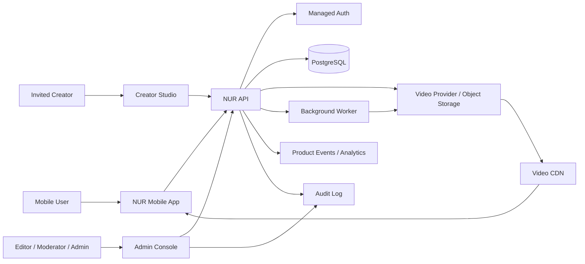
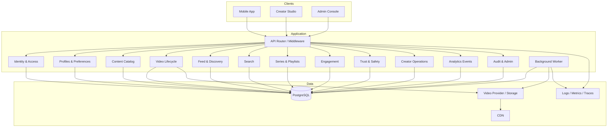
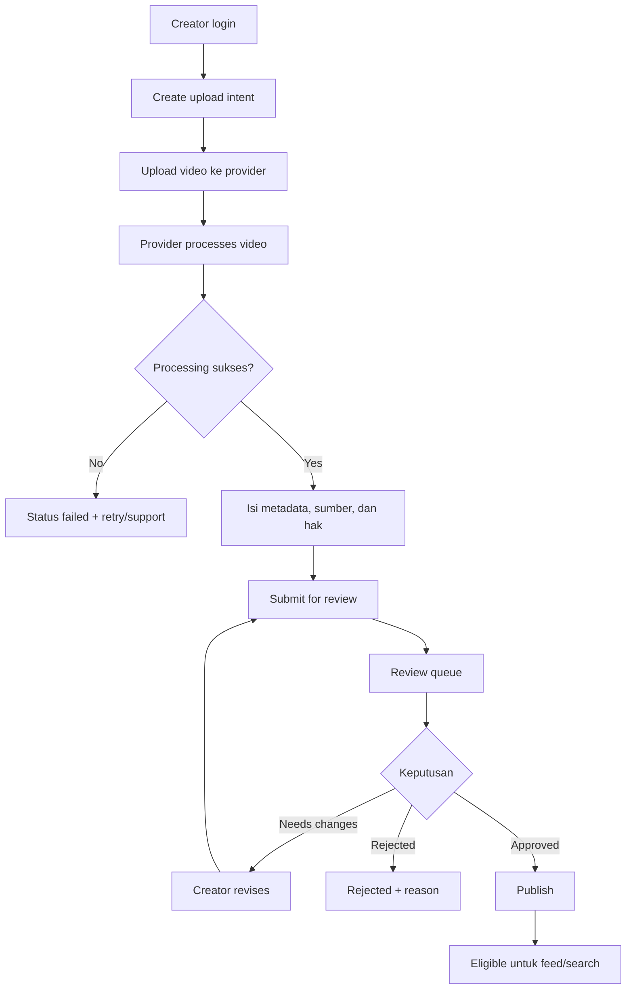
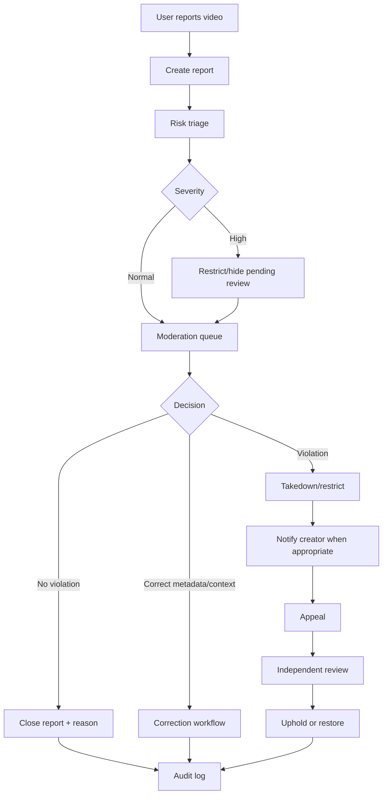
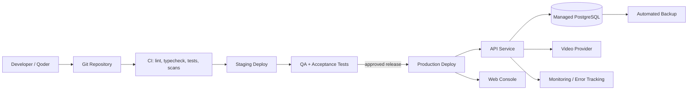
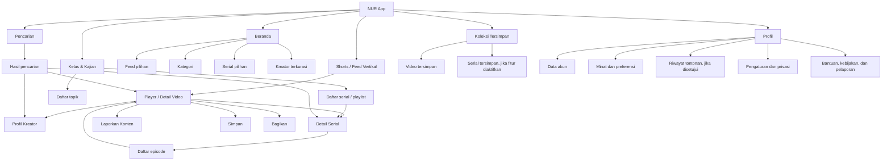
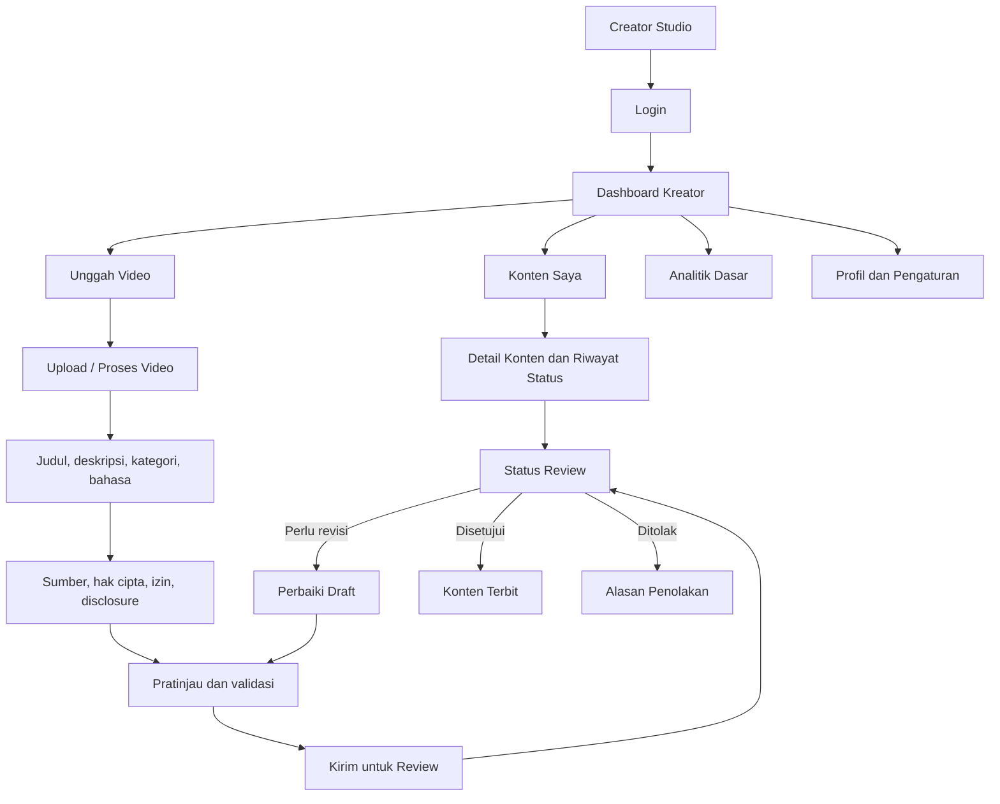
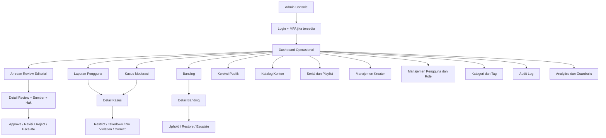

# NUR Platform — High-Level Design (HLD)
**Dokumen:** NUR-HLD-001  
**Versi:** 1.1 — Draft dengan UX/UI reference yang mengikat  
**Tanggal:** 20 Oktober 2026  
**Status:** Proposed — UX/UI reference disetujui sebagai acuan visual; keputusan teknis yang belum final tetap OPEN DECISION  
**Target implementasi:** Qoder, per-project repository  
**Produk:** NUR — Short Islamic Video Platform

---

## 1. Tujuan dokumen

Dokumen ini menerjemahkan NUR Platform Deck menjadi rancangan teknis tingkat tinggi untuk membangun MVP. Dokumen ini menetapkan batas sistem, komponen, tanggung jawab, data utama, API konseptual, alur penting, kontrol keamanan, strategi pengujian, serta tahapan implementasi.

HLD ini bukan pengganti Low-Level Design (LLD), API specification final, migration SQL, UI specification, atau threat model. Semua detail yang belum diputuskan harus dicatat sebagai **OPEN DECISION** dan tidak boleh diisi diam-diam oleh coding agent.

### 1.1 Prinsip produk yang harus dipertahankan

1. **Trust by design:** sumber, hak cipta, review, koreksi, pelaporan, banding, dan audit adalah bagian inti produk.
2. **Curated-first:** hanya kreator yang diundang/diverifikasi yang dapat mengirim konten untuk publikasi pada MVP.
3. **Mobile-first:** pengalaman utama adalah feed video vertikal.
4. **Learning journey:** konten pendek harus dapat dirangkai menjadi playlist/serial bertahap.
5. **Modular, tidak over-engineered:** mulai dengan satu backend modular; pisahkan layanan hanya bila skala dan kebutuhan operasional membuktikannya.
6. **Monetisasi bertahap:** sponsorship lebih dahulu; membership, kelas, dan ekosistem setelah retensi terbukti.
7. **Evidence-driven:** keputusan produk berikutnya berdasarkan metrik retensi, kualitas konten, biaya video, moderasi, dan kepercayaan.
8. **No unsupported religious authority claims:** NUR bukan otoritas fatwa; isu agama kompleks diarahkan ke sumber/ahli yang kompeten.

---

## 2. Ringkasan eksekutif

NUR adalah platform video pendek Islami untuk pengguna Indonesia. Konten awal meliputi:
- **Ilmu Praktis:** doa dan adab harian, ibadah, keluarga, akhlak, tanya-jawab singkat dengan rujukan.
- **Kisah & Inspirasi:** kisah teladan, sejarah Islam, refleksi, perjalanan hijrah dengan sumber dan konteks.
- **Serial Terstruktur:** playlist sekitar 5–10 episode untuk belajar secara bertahap.

Format target dalam deck adalah video vertikal berdurasi sekitar 15–90 detik. MVP membuktikan loop:
**Temukan → Tonton → Simpan/Bagikan → Lanjutkan serial.**

### 2.1 Sasaran MVP

- Pengguna dapat menemukan dan menonton video pendek.
- Pengguna dapat mencari, menyimpan, membagikan, dan melanjutkan serial.
- Kreator terpilih dapat mengunggah video, mengisi metadata/sumber/hak, dan melihat status review.
- Editor/reviewer dapat memeriksa konten, meminta revisi, menyetujui, menolak, atau mengeskalasi.
- Moderator dapat memproses laporan, takedown, banding, dan koreksi.
- Admin dapat mengelola pengguna, kategori, playlist, kebijakan, dan audit.
- Tim produk dapat mengukur event inti, completion, retention, save/share, continuation, dan biaya delivery video.

### 2.2 Bukan sasaran MVP

- Live streaming.
- Open upload untuk semua pengguna.
- Marketplace atau sistem pembayaran kompleks.
- Feed rekomendasi machine-learning yang membutuhkan infrastruktur tersendiri.
- Chat/messaging antar pengguna.
- Monetisasi membership yang kompleks sebelum ada bukti retensi.
- Aplikasi desktop.

---

## 3. Asumsi dan keputusan arsitektur yang diusulkan

Bagian ini adalah rekomendasi teknis untuk memulai, bukan fakta yang sudah ditentukan oleh deck.

| Area | Keputusan awal yang diusulkan | Alasan / catatan |
|---|---|---|
| Mobile app | React Native + Expo + TypeScript | Satu codebase mobile, ekosistem TypeScript. Validasi dukungan video player dan kebutuhan native sebelum dikunci. |
| Admin & Creator Studio | React + Vite + TypeScript | Cocok untuk dashboard operasional dan konsisten dengan stack web modern. |
| UI web | Tailwind CSS + design tokens | Konsistensi desain; token warna/spacing ditetapkan di design system. |
| Backend API | FastAPI + Python | Cocok untuk API terstruktur dan analitik; gunakan OpenAPI sebagai kontrak. |
| Database | PostgreSQL | Relasi pengguna, konten, review, playlist, dan audit. |
| Auth | Managed auth yang mendukung email/OTP dan role mapping; kandidat Supabase Auth | Hindari membangun sistem password sendiri. Keputusan final setelah uji kebutuhan. |
| Video storage/delivery | Managed video platform atau object storage + transcoding + CDN | Video delivery adalah pusat biaya dan risiko. Lakukan proof-of-concept biaya, playback, signed upload, captions, dan analytics sebelum memilih vendor. |
| Metadata storage | PostgreSQL | Database menyimpan metadata dan status, bukan file video biner. |
| Background jobs | Queue/worker terkelola atau worker sederhana dengan retry | Untuk transcode callbacks, thumbnails, notifikasi, dan analytics aggregation. Jangan menambahkan message broker kompleks tanpa kebutuhan. |
| Search MVP | PostgreSQL full-text search | Cukup untuk katalog awal; search service khusus hanya bila diperlukan. |
| Analytics | Event table terstruktur + dashboard analytics | Event harus memiliki schema/version dan kebijakan privasi. |
| Deployment | Containerized API + managed database/storage; staging dan production terpisah | Vendor final harus diputuskan melalui biaya, region, SLA, dan data processing review. |
| Monorepo | pnpm workspace untuk frontend; backend Python terpisah di repo yang sama | Memudahkan kontrak dan dokumentasi bersama. |

**Open decisions sebelum production:** provider video, provider auth, target platform (Android lebih dulu atau Android+iOS), kebijakan umur minimum, data residency, legal entity, dan vendor analytics.

---

## 4. Konteks dan batas sistem

### 4.1 Aktor

1. **Visitor:** belum login; melihat konten publik yang diizinkan.
2. **Registered User:** menonton, menyimpan, membagikan, mengikuti serial, mengatur minat, dan melaporkan konten.
3. **Creator:** kreator yang diundang; mengelola profil kreator dan mengirim draft video.
4. **Editor/Reviewer:** menilai kualitas, sumber, konteks, hak cipta, dan kelayakan editorial.
5. **Moderator:** memproses laporan, takedown, koreksi, dan banding sesuai kewenangan.
6. **Scholar/Advisor:** memberi masukan sesuai kompetensi; tidak otomatis memiliki hak admin teknis.
7. **Admin:** mengelola konfigurasi, kategori, pengguna, role, dan operasional.
8. **Analyst/Product Operator:** membaca metrik agregat dengan akses terbatas terhadap data personal.
9. **Sponsor/Partner (fase berikutnya):** belum memiliki akses dashboard pada MVP.

### 4.2 System context



### 4.3 Batas tanggung jawab

- **NUR API** adalah sumber kebenaran untuk metadata, status publikasi, role, hak akses, dan aturan bisnis.
- **Video provider/storage** menangani penyimpanan dan delivery media; tidak menentukan apakah video boleh tampil di NUR.
- **Managed Auth** memverifikasi identitas. Backend tetap wajib memeriksa role dan permission untuk setiap aksi sensitif.
- **Analytics** digunakan untuk pengukuran produk; bukan sumber kebenaran status konten atau transaksi.
- **Admin Console** tidak boleh mengakses database secara langsung dari browser.
- **Client app** tidak boleh menentukan sendiri bahwa konten draft/rejected/taken-down boleh ditonton.

---

## 5. Arsitektur logis

### 5.1 Lapisan

1. **Experience layer**
   - NUR Mobile App.
   - Creator Studio.
   - Admin & Moderation Console.

2. **API / application layer**
   - Identity & Profile.
   - Catalog & Content.
   - Video Lifecycle.
   - Feed & Discovery.
   - Search.
   - Playlist & Series.
   - User Engagement.
   - Trust & Safety.
   - Creator Operations.
   - Analytics Events.
   - Admin & Audit.

3. **Data layer**
   - PostgreSQL.
   - Video storage/provider.
   - Cache opsional setelah profiling.
   - Analytics/event storage.

4. **Operations layer**
   - Background worker.
   - Observability/logging.
   - CI/CD.
   - Backup/restore.
   - Secrets/configuration.
   - Moderation operations.

### 5.2 Gaya arsitektur

Gunakan **modular monolith** untuk API MVP:
- Satu deployment backend.
- Modul bisnis dipisah melalui package/module boundaries.
- Modul berinteraksi lewat service/interface internal, bukan saling mengakses tabel secara sembarangan.
- Background worker dapat menjadi proses deployment terpisah, tetapi memakai codebase dan domain modules yang sama.
- Tidak membuat microservices sebelum ada bukti bottleneck, kebutuhan isolasi, atau tim independen.

### 5.3 Diagram komponen



---

## 6. Modul dan tanggung jawab

### 6.1 Identity & Access
- Validasi access token dari managed auth.
- Pemetaan identitas ke profil internal.
- Role-based access control (RBAC).
- Status akun: active, suspended, deleted/pending deletion.
- Admin wajib memakai autentikasi kuat/MFA jika provider mendukung.
- Jangan menyimpan password mentah atau membuat mekanisme password sendiri.

### 6.2 Profile & Preferences
- Profil pengguna dan kreator.
- Preferensi kategori/minat.
- Preferensi bahasa/subtitle bila dibutuhkan.
- Status onboarding.
- Pengaturan privasi dan permintaan penghapusan akun.

### 6.3 Content Catalog
- Metadata video, judul, deskripsi, kategori, bahasa, durasi, thumbnail, caption, sumber, label editorial, dan hak.
- Status editorial dan publikasi.
- Validasi metadata wajib.
- Hanya konten berstatus published/available yang dapat dikembalikan untuk playback publik.

### 6.4 Video Lifecycle
- Membuat upload intent untuk kreator yang berhak.
- Menghasilkan signed upload URL/token bila provider mendukung.
- Menerima callback proses upload/transcoding dengan verifikasi signature.
- Merekam status: initiated, uploading, processing, ready_for_review, failed, archived.
- Menyimpan referensi asset/provider ID, durasi, resolusi, thumbnail, dan playback reference.
- Menangani retry idempotent dan kegagalan provider.
- Tidak menganggap upload berhasil berarti konten boleh dipublikasikan.

### 6.5 Feed & Discovery
- Mengembalikan daftar video eligible berdasarkan status publikasi, kategori, bahasa, dan aturan ranking sederhana.
- Pagination berbasis cursor.
- Exclude video yang ditakedown, belum direview, atau tidak sesuai audience policy.
- Ranking MVP transparan dan sederhana: editorial pin/priority, freshness, category relevance, serta diversifikasi.
- Hindari mengklaim rekomendasi personal canggih pada MVP.

### 6.6 Search
- Pencarian judul, deskripsi, kategori, kreator, dan serial yang sudah dipublikasikan.
- Filter kategori/durasi/jenis konten.
- PostgreSQL full-text search pada MVP.
- Jangan memasukkan draft atau konten restricted ke hasil publik.

### 6.7 Series & Playlists
- Membuat serial tematik dan playlist.
- Menentukan urutan episode.
- Menandai episode sebelumnya/berikutnya.
- Mengukur continuation rate.
- Validasi urutan dan publikasi episode.

### 6.8 Engagement
- Watch events, completion, save/unsave, share intent, follow series (bila disetujui sebagai MVP), dan progress episode.
- Simpan interaksi pengguna sesuai kebijakan retensi.
- Share tidak boleh mengungkap data pribadi pengguna.
- Watch duration dari client diperlakukan sebagai telemetry, bukan bukti anti-fraud yang sempurna.

### 6.9 Creator Operations
- Onboarding kreator berbasis undangan.
- Profil, status verifikasi, hak upload.
- Daftar draft dan status review.
- Ringkasan performa konten yang hanya menampilkan data yang diizinkan.
- Pada MVP tidak ada payout otomatis.

### 6.10 Trust & Safety
- Review queue dan keputusan editorial.
- User reports.
- Takedown dan pembatasan visibilitas.
- Koreksi publik dan version history.
- Appeals/banding dengan reviewer berbeda bila memungkinkan.
- Escalation untuk risiko tinggi.
- Bukti izin/hak cipta.
- Audit trail yang tidak dapat diubah lewat UI biasa.

### 6.11 Admin & Audit
- Manajemen role dan status akun.
- Kategori, tag, label editorial, konfigurasi feed.
- Audit setiap tindakan sensitif.
- Least privilege: admin teknis, reviewer, moderator, dan analyst dipisah.
- Ekspor data dibatasi dan dicatat.

### 6.12 Analytics
- Schema event berversi.
- Event ingestion idempotent bila ada event ID.
- Dashboard agregat untuk funnel, completion, D1/D7/D30 retention, save/share, serial continuation, creator quality, reports, dan biaya video.
- Hindari mengirim teks pribadi atau data sensitif yang tidak diperlukan ke analytics.

---

## 7. Alur bisnis utama

### 7.1 Upload sampai publikasi



Ketentuan:
- Creator tidak dapat menyetujui kontennya sendiri.
- Approval dan publish boleh menjadi satu aksi untuk MVP, tetapi keduanya harus tercatat dalam audit log.
- Konten yang belum memiliki bukti hak/sumber yang diwajibkan tidak dapat dikirim untuk review.
- Callback provider harus diverifikasi dan idempotent.
- Konten tidak tampil di feed sampai seluruh syarat publikasi terpenuhi.

### 7.2 Laporan dan takedown



Kebijakan detail untuk jenis laporan, SLA, konten berisiko tinggi, dan perlindungan anak harus ditetapkan oleh pemilik produk dan penasihat yang kompeten sebelum beta publik.

### 7.3 Pengalaman menonton

1. App meminta feed dengan cursor.
2. API mengembalikan metadata video yang eligible dan playback reference yang aman.
3. App memuat video melalui provider/CDN.
4. App mengirim event `video_impression` dan `video_started`.
5. App mengirim progress/completion dengan batching dan batas frekuensi.
6. Pengguna dapat menyimpan, membagikan, atau membuka serial.
7. API memvalidasi interaksi dan mencatat event.
8. Analytics menghitung completion, meaningful session, dan continuation.

### 7.4 Definisi awal meaningful watch session

Deck mendefinisikan north star sebagai meaningful watch sessions per weekly active user. Untuk MVP, definisi operasional perlu disepakati. Usulan awal yang dapat diuji:
- Sesi menonton berisi setidaknya satu video yang melewati ambang watch-time yang ditetapkan.
- Sesi dianggap bermakna bila pengguna menyelesaikan video, menyimpan, membagikan, atau melanjutkan serial.
- Ambang dan aturan deduplikasi ditetapkan dalam analytics specification, bukan ditanam berbeda di tiap layar.

---

## 8. Model data tingkat tinggi

Model ini konseptual. Nama tabel, tipe data, constraints, index, dan migrations final ditetapkan di LLD.

### 8.1 Entitas inti

| Entitas | Tujuan | Field konseptual utama |
|---|---|---|
| `users` | Profil internal pengguna | id, auth_subject, display_name, status, created_at |
| `user_roles` | Role dan scope | user_id, role, scope, granted_by, granted_at |
| `user_preferences` | Minat dan onboarding | user_id, category_ids, language, onboarding_completed |
| `creators` | Profil kreator | id, user_id, public_name, verification_status, status |
| `videos` | Metadata video | id, creator_id, title, description, duration, language, category_id, status |
| `video_assets` | Asset provider | id, video_id, provider, provider_asset_id, playback_ref, thumbnail_ref, processing_status |
| `video_sources` | Rujukan konten | id, video_id, source_type, citation_text, source_url, checked_by |
| `rights_records` | Hak dan izin | id, video_id, rights_type, permission_reference, status, expires_at |
| `editorial_reviews` | Review editorial | id, video_id, reviewer_id, decision, reason_code, notes, created_at |
| `video_versions` | Riwayat revisi | id, video_id, version_no, metadata_snapshot, created_at |
| `categories` | Kategori konten | id, name, slug, status |
| `series` | Serial pembelajaran | id, title, description, category_id, status |
| `series_episodes` | Urutan episode | series_id, video_id, episode_number |
| `playlists` | Koleksi video | id, title, description, owner_type, status |
| `playlist_items` | Isi playlist | playlist_id, video_id, position |
| `saved_videos` | Video tersimpan | user_id, video_id, created_at |
| `watch_events` | Event menonton | event_id, user_id/anonymous_id, video_id, event_type, position_ms, occurred_at |
| `user_reports` | Laporan pengguna | id, reporter_id, video_id, reason_code, details, status |
| `moderation_cases` | Kasus moderasi | id, report_id, assignee_id, severity, status, resolution |
| `appeals` | Banding | id, case_id, creator_id, reason, status, decision_by |
| `corrections` | Koreksi publik | id, video_id, correction_text, published_at, status |
| `audit_logs` | Jejak tindakan sensitif | id, actor_id, action, entity_type, entity_id, reason, created_at |
| `analytics_events` | Event produk berversi | event_id, event_name, schema_version, actor_ref, payload_limited, occurred_at |
| `sponsor_campaigns` | Placeholder fase berikutnya | Tidak perlu diimplementasikan pada MVP kecuali scope disetujui |

### 8.2 Aturan data

- Gunakan UUID/ID stabil; jangan expose sequential database IDs bila tidak diperlukan.
- Semua timestamp disimpan konsisten dalam UTC; API mengirim ISO 8601.
- Tambahkan `created_at`, `updated_at`, dan bila relevan `created_by` pada entitas operasional.
- Gunakan soft-delete hanya bila ada kebutuhan audit/retensi yang jelas; tetapkan kebijakan penghapusan data.
- Status workflow menggunakan enum/constraint yang tervalidasi, bukan string bebas.
- Terapkan unique constraint untuk interaksi seperti `(user_id, video_id)` pada saved videos.
- Tambahkan index untuk status publikasi, kategori, creator, tanggal publikasi, serial/episode, serta foreign keys yang sering dicari.
- Jangan menyimpan binary video di PostgreSQL.
- Payload analytics harus minimal, tervalidasi, dan tidak mengandung credential, token, atau informasi sensitif.

### 8.3 Status video yang disarankan

Pisahkan status pemrosesan media dan status editorial/publikasi.

**Media processing:** `initiated`, `uploading`, `processing`, `ready`, `failed`.

**Editorial status:** `draft`, `submitted`, `in_review`, `changes_requested`, `approved`, `rejected`.

**Publication status:** `unpublished`, `published`, `restricted`, `taken_down`, `archived`.

Jangan menyatukan ketiganya ke satu status karena video bisa selesai diproses tetapi belum lolos review.

---

## 9. API design tingkat tinggi

### 9.1 Prinsip API

- Prefix versi: `/api/v1`.
- JSON untuk API metadata.
- OpenAPI sebagai kontrak yang dihasilkan dan diuji.
- Cursor pagination untuk feed dan daftar besar.
- Validasi input pada boundary.
- Error response konsisten: `code`, `message`, `request_id`, dan `details` yang aman.
- Idempotency key untuk operasi yang dapat diulang dan berisiko membuat duplikasi.
- Rate limiting untuk login, upload intent, report, dan event ingestion.
- Jangan mengembalikan internal notes moderator kepada pengguna umum.
- Semua endpoint admin memeriksa role/permission di backend.

### 9.2 Endpoint konseptual MVP

**Public / user**
- `GET /api/v1/feed?cursor=...&category=...`
- `GET /api/v1/videos/{video_id}`
- `GET /api/v1/search?q=...&category=...&cursor=...`
- `GET /api/v1/series`
- `GET /api/v1/series/{series_id}`
- `GET /api/v1/me`
- `PATCH /api/v1/me/preferences`
- `PUT /api/v1/me/saved-videos/{video_id}`
- `DELETE /api/v1/me/saved-videos/{video_id}`
- `GET /api/v1/me/saved-videos?cursor=...`
- `POST /api/v1/videos/{video_id}/reports`
- `POST /api/v1/analytics/events` (batch terbatas)

**Creator**
- `GET /api/v1/creator/videos`
- `POST /api/v1/creator/videos`
- `POST /api/v1/creator/videos/{video_id}/upload-intent`
- `PATCH /api/v1/creator/videos/{video_id}`
- `POST /api/v1/creator/videos/{video_id}/submit-review`
- `GET /api/v1/creator/videos/{video_id}/status`
- `GET /api/v1/creator/analytics/summary`

**Reviewer / moderator / admin**
- `GET /api/v1/admin/review-queue`
- `GET /api/v1/admin/videos/{video_id}/review-context`
- `POST /api/v1/admin/videos/{video_id}/review-decision`
- `GET /api/v1/admin/reports`
- `POST /api/v1/admin/moderation-cases/{case_id}/decision`
- `POST /api/v1/admin/moderation-cases/{case_id}/restrict`
- `POST /api/v1/admin/appeals/{appeal_id}/decision`
- `POST /api/v1/admin/videos/{video_id}/corrections`
- `GET /api/v1/admin/audit-logs`
- `POST /api/v1/admin/creators/{creator_id}/status`

Endpoint di atas adalah daftar konseptual, bukan spesifikasi final. Setiap endpoint perlu request/response schema, permission matrix, status code, rate limit, dan contract test di LLD.

### 9.3 Kontrak respons feed konseptual

```json
{
  "items": [
    {
      "id": "video_uuid",
      "title": "Contoh judul",
      "description": "Deskripsi singkat",
      "creator": {
        "id": "creator_uuid",
        "display_name": "Nama Kreator",
        "verification_status": "verified"
      },
      "category": {
        "id": "category_uuid",
        "name": "Ilmu Praktis"
      },
      "duration_seconds": 45,
      "thumbnail_url": "https://provider.example/thumbnail",
      "playback_ref": "provider_playback_reference",
      "captions_available": true,
      "published_at": "2026-10-20T08:00:00Z",
      "series": {
        "id": "series_uuid",
        "title": "Adab Harian",
        "episode_number": 2,
        "total_episodes": 6
      }
    }
  ],
  "next_cursor": "opaque_cursor_or_null"
}
```

URL dan provider fields di atas hanya ilustrasi. Gunakan URL bertanda tangan atau playback token sesuai kemampuan provider. Jangan membuat playback URL permanen yang melewati kontrol akses jika konten kelak memiliki pembatasan.

---

## 10. Role dan permission matrix

| Aksi | User | Creator | Reviewer | Moderator | Admin |
|---|---:|---:|---:|---:|---:|
| Menonton konten publik | Ya | Ya | Ya | Ya | Ya |
| Menyimpan/melaporkan | Ya | Ya | Ya | Ya | Ya |
| Membuat draft video | Tidak | Ya | Opsional | Tidak | Sesuai tugas |
| Mengirim konten review | Tidak | Ya | Tidak | Tidak | Sesuai tugas |
| Menyetujui konten sendiri | Tidak | Tidak | Tidak jika conflict | Tidak | Tidak sebagai default |
| Review editorial | Tidak | Tidak | Ya | Terbatas sesuai policy | Ya bila ditugaskan |
| Takedown/restrict | Tidak | Tidak | Eskalasi saja | Ya | Ya |
| Memutuskan banding | Tidak | Tidak | Sebaiknya reviewer berbeda | Sesuai policy | Ya dengan audit |
| Mengelola role | Tidak | Tidak | Tidak | Tidak | Ya |
| Melihat audit log | Tidak | Milik sendiri terbatas | Scope tugas | Scope tugas | Ya, dibatasi dan diaudit |

Role harus diperiksa di server. Menyembunyikan tombol di frontend bukan kontrol keamanan.

---

## 11. Video pipeline dan media delivery

### 11.1 Persyaratan

- Upload hanya untuk kreator yang diizinkan.
- Batas ukuran, durasi, format, dan jumlah upload harus dikonfigurasi.
- File diperiksa tipe dan status prosesnya.
- Transcoding menghasilkan profil playback yang sesuai perangkat/jaringan.
- Thumbnail dibuat oleh provider atau worker.
- Captions/subtitles didukung sebagai metadata atau asset.
- Playback memakai CDN dan mekanisme aman provider.
- Provider webhook harus diverifikasi, dicatat, dan diproses secara idempotent.
- Kegagalan upload/transcoding dapat di-retry tanpa membuat video duplikat.
- Video takedown harus segera dikeluarkan dari feed/search; invalidasi cache/CDN mengikuti kemampuan provider.
- Pantau biaya delivery per jam tonton, resolusi, bitrate, dan cache hit bila tersedia.

### 11.2 Provider selection gate

Sebelum memilih vendor, lakukan proof-of-concept dengan video uji yang sama dan bandingkan:
1. Kualitas playback dan startup time pada jaringan Indonesia.
2. Adaptive bitrate dan dukungan portrait video.
3. Signed upload dan kontrol playback.
4. Transcoding, thumbnail, captions, webhook.
5. Proteksi konten dan takedown.
6. Biaya storage, transcoding, delivery, dan egress pada skenario rendah/base/tinggi.
7. Log, metrik, exportability, dan risiko vendor lock-in.
8. Kebijakan privasi, lokasi pemrosesan data, SLA, dan terms.

Jangan mengunci provider hanya berdasarkan harga storage; delivery video biasanya komponen biaya utama.

---

## 12. Trust, editorial governance, dan safety

### 12.1 Metadata editorial minimum

Setiap video yang disubmit harus memiliki:
- Judul dan deskripsi.
- Kategori dan bahasa.
- Kreator/penanggung jawab.
- Tipe konten: edukasi, opini, promosi, kisah, atau tipe yang ditetapkan policy.
- Sumber/rujukan bila relevan.
- Status hak cipta dan bukti izin bila menggunakan materi pihak lain.
- Deklarasi sponsor/promosi bila ada.
- Informasi caption/subtitle bila tersedia.
- Reviewer decision dan alasan.
- Version history untuk perubahan penting.

### 12.2 Review berbasis risiko

- Konten rutin dengan sumber dan hak jelas mengikuti antrean normal.
- Konten yang membahas hukum agama kompleks, klaim sensitif, anak, hak cipta, atau risiko reputasi diekskalasi sesuai policy.
- Konflik kepentingan reviewer harus dideklarasikan.
- Tidak ada klaim bahwa NUR menjadi otoritas fatwa.
- Perbedaan perspektif harus ditangani dengan adab dan konteks; jangan menjadikan isu khilafiyah sebagai umpan engagement.

### 12.3 Auditability

Catat minimal:
- Siapa melakukan aksi.
- Aksi dan entitas yang terpengaruh.
- Waktu.
- Alasan atau reason code.
- Nilai sebelum/sesudah bila relevan.
- Request/correlation ID.
- Hasil keputusan.

Audit log tidak boleh bisa diedit atau dihapus oleh reviewer/moderator melalui UI biasa.

---

## 13. Keamanan dan privasi

### 13.1 Kontrol minimum

- TLS untuk semua koneksi.
- Secrets hanya melalui environment secret manager; tidak pernah commit ke repository.
- Managed auth; token divalidasi server-side.
- RBAC dan least privilege.
- Validasi input dan output encoding.
- Rate limiting dan abuse controls.
- Signed upload/playback reference bila didukung.
- Webhook signature verification.
- CORS allowlist untuk aplikasi web.
- Proteksi CSRF sesuai pola auth web yang dipilih.
- SQL parameterization/ORM yang aman.
- Dependency scanning dan secret scanning di CI.
- Backup terenkripsi dan uji restore.
- Audit log untuk aksi administratif.
- Pemisahan environment development, staging, production.
- Redaksi PII dari log.
- Tidak menjual data sensitif; sponsor tidak boleh mendapat data personal pengguna.

### 13.2 Privasi dan retensi

Sebelum beta publik, tetapkan:
- Privacy policy dan terms.
- Dasar pemrosesan dan tujuan setiap data.
- Umur minimum dan aturan perlindungan anak.
- Retensi event/watch history/report/audit.
- Mekanisme akses, koreksi, ekspor, dan penghapusan akun sesuai hukum yang berlaku.
- Kebijakan analytics dan consent bila diperlukan.
- Prosedur incident response.
- Data processor/subprocessor dari vendor.

### 13.3 Ancaman yang perlu dimodelkan

- Upload file berbahaya atau format yang tidak valid.
- Creator menyiasati status review.
- User mengirim laporan massal palsu.
- Credential theft dan penyalahgunaan role admin.
- Webhook palsu/replay.
- Scraping katalog dan abuse API.
- Konten melanggar hak cipta.
- Takedown tidak terpropagasi ke feed/cache.
- Kebocoran informasi privat lewat analytics/logs.
- Biaya video melonjak karena abuse atau playback otomatis.

Threat model rinci harus menjadi dokumen tersendiri sebelum production.

---

## 14. Non-functional requirements (NFR)

Target di bawah adalah **target awal untuk diuji**, bukan SLA yang telah disepakati.

| Area | Target awal / kriteria |
|---|---|
| Availability | Tetapkan target setelah vendor dan operasi dipilih; monitoring wajib untuk API, database, dan video provider. |
| API latency | P95 endpoint metadata/feed < 500 ms pada staging dengan dataset uji yang representatif, tidak termasuk startup/delivery video. |
| Feed responsiveness | Gunakan cursor pagination, metadata ringan, dan prefetch terbatas; validasi pada perangkat Android kelas menengah. |
| Playback | Ukur startup time, rebuffer ratio, completion, dan error per jaringan/perangkat. Tetapkan target setelah POC. |
| Security | Tidak ada secret di repo; seluruh endpoint sensitif memiliki permission tests; dependency/security scan di CI. |
| Data integrity | Foreign keys, constraints, idempotent callbacks, dan transaksi untuk perubahan status penting. |
| Recoverability | Backup otomatis dan restore drill berkala sebelum production. RPO/RTO ditetapkan setelah memilih layanan. |
| Observability | Request ID, structured logs, error tracking, metrics, dan alert untuk error rate serta provider failures. |
| Accessibility | Kontras memadai, caption support, kontrol yang dapat diakses, dan pengujian dasar screen reader. |
| Localization | Bahasa Indonesia sebagai bahasa awal; struktur siap untuk bahasa tambahan. |
| Maintainability | Type checking, lint, formatting, test suite, ADR, dan dokumentasi kontrak. |
| Cost control | Dashboard biaya video dan alert terhadap lonjakan storage/transcoding/delivery. |

---

## 15. Analytics dan metrik produk

### 15.1 Event awal

- `app_opened`
- `onboarding_completed`
- `feed_loaded`
- `video_impression`
- `video_started`
- `video_progress`
- `video_completed`
- `video_saved`
- `video_unsaved`
- `video_shared`
- `series_opened`
- `series_episode_started`
- `series_episode_completed`
- `search_performed`
- `content_report_submitted`
- `creator_upload_started`
- `creator_upload_completed`
- `content_submitted_for_review`
- `content_review_decided`
- `content_taken_down`
- `appeal_submitted`

Setiap event mempunyai `event_id`, `event_name`, `schema_version`, timestamp, app version, dan actor reference yang dipseudonimkan bila memungkinkan. Jangan mengirim token, password, atau isi laporan sensitif ke analytics umum.

### 15.2 Metrik

**North star:** meaningful watch sessions per weekly active user.

**Retention/engagement:** D1/D7/D30, sesi per minggu, completion rate, saves, shares, continuation rate serial.

**Creator/content:** jumlah kreator aktif, waktu dari submit sampai keputusan, approval/revision/rejection rate, konten berkualitas konsisten.

**Trust & safety:** laporan valid, waktu penyelesaian laporan, tingkat koreksi, insiden hak cipta, banding yang dikabulkan, kepuasan kreator.

**Unit economics:** biaya streaming per jam tonton, biaya moderasi per 1.000 unggahan, revenue per active user, CAC, payback.

Jangan menetapkan angka sukses final sebelum baseline pilot diperoleh. Target perlu ditulis sebagai eksperimen atau stage gate yang dapat dievaluasi.

---

## 16. Deployment dan lingkungan

### 16.1 Environment

- **Local:** developer environment, data sintetis, mock provider bila diperlukan.
- **CI/Test:** lint, typecheck, unit/integration/contract tests, migration validation, dependency scans.
- **Staging:** konfigurasi mirip production, video provider sandbox, test users dan test content.
- **Production:** akses terbatas, secrets terpisah, backup, monitoring, incident runbook.

### 16.2 Deployment konseptual



### 16.3 Backup dan recovery

- Aktifkan backup database terjadwal sesuai kemampuan vendor.
- Dokumentasikan restore procedure dan jalankan restore drill.
- Video asset backup/replication mengikuti kemampuan dan biaya provider; jangan mengasumsikan backup database mencakup video.
- Simpan migration version dan release version.
- Sediakan prosedur rollback untuk aplikasi; migration yang destruktif memerlukan strategi expand-migrate-contract.
- Catat keputusan dan hasil setiap insiden.

---

## 17. Struktur repository yang diusulkan untuk Qoder

```text
nur-platform/
├── README.md
├── AGENTS.md
├── .qoder/
│   └── project-rules.md
├── docs/
│   ├── product/
│   │   ├── product-brief.md
│   │   ├── mvp-scope.md
│   │   ├── navigation-and-sitemap.md
│   │   ├── user-journeys.md
│   │   └── glossary.md
│   ├── architecture/
│   │   ├── HLD.md
│   │   ├── system-context.md
│   │   ├── data-model.md
│   │   ├── api-overview.md
│   │   ├── route-permission-matrix.md
│   │   ├── security-privacy.md
│   │   ├── video-pipeline.md
│   │   └── adr/
│   │       ├── ADR-0001-modular-monolith.md
│   │       ├── ADR-0002-video-provider.md
│   │       └── ADR-0003-auth-provider.md
│   ├── operations/
│   │   ├── local-development.md
│   │   ├── deployment.md
│   │   ├── backup-restore.md
│   │   └── moderation-runbook.md
│   └── quality/
│       ├── test-strategy.md
│       └── acceptance-criteria.md
├── apps/
│   ├── mobile/              # React Native / Expo (proposal)
│   ├── creator-studio/      # React + Vite
│   └── admin-console/       # React + Vite
├── backend/
│   ├── app/
│   │   ├── main.py
│   │   ├── api/
│   │   ├── core/
│   │   ├── modules/
│   │   │   ├── identity/
│   │   │   ├── profiles/
│   │   │   ├── catalog/
│   │   │   ├── video_lifecycle/
│   │   │   ├── feed/
│   │   │   ├── search/
│   │   │   ├── series/
│   │   │   ├── engagement/
│   │   │   ├── creators/
│   │   │   ├── trust_safety/
│   │   │   ├── analytics/
│   │   │   └── admin/
│   │   ├── integrations/
│   │   │   ├── auth_provider/
│   │   │   └── video_provider/
│   │   └── workers/
│   ├── tests/
│   ├── pyproject.toml
│   └── alembic/
├── packages/
│   ├── api-client/          # generated/typed client when appropriate
│   ├── shared-types/
│   └── design-tokens/
├── database/
│   ├── seeds/
│   └── diagrams/
├── infra/
│   ├── local/
│   ├── staging/
│   └── production/
├── scripts/
├── .github/
│   └── workflows/
└── .env.example
```

Catatan:
- Struktur ini usulan awal, bukan keharusan untuk membuat semua folder langsung.
- Jangan membuat file kosong dalam jumlah besar hanya untuk terlihat lengkap.
- Jika Qoder atau tool aktual memiliki mekanisme rules berbeda, verifikasi dokumentasi/tool aktual sebelum menetapkan konvensi.
- Jangan menyimpan API key, token, atau data pengguna nyata di contoh/env file.
- Semua keputusan besar dicatat sebagai ADR.

---

## 18. Strategi pengujian

### 18.1 Jenis tes

1. **Unit tests:** aturan status konten, permission, ranking feed, validasi metadata.
2. **Integration tests:** PostgreSQL, auth adapter, video provider adapter, worker callbacks.
3. **API contract tests:** request/response schema, status code, permission, pagination, error shape.
4. **Workflow tests:** upload → processing → review → publish; report → takedown → appeal.
5. **Security tests:** RBAC negative tests, rate limiting, webhook signature, input validation.
6. **Mobile UI tests:** onboarding, playback, save, search, serial continuation, error/retry.
7. **Performance tests:** feed query, event ingestion, video playback measurements.
8. **Recovery tests:** database restore dan migration rollback/forward strategy.
9. **Accessibility tests:** caption controls, contrast, screen reader basics.
10. **Acceptance tests:** setiap requirement MVP memiliki kriteria lulus yang eksplisit.

### 18.2 Release gate minimum

Rilis tidak boleh diteruskan jika:
- Ada secret terdeteksi di repository.
- Ada endpoint admin tanpa permission test.
- Video yang belum approved bisa tampil di feed/search.
- Callback provider dapat dipalsukan tanpa verifikasi.
- Takedown tidak menghilangkan video dari discovery.
- Upload/review workflow tidak dapat dipulihkan setelah kegagalan.
- Backup/restore belum pernah diuji sebelum production.
- Pelaporan dan prosedur moderasi belum berfungsi untuk beta publik.

---

## 19. Tahapan implementasi untuk Qoder

Gunakan urutan **Architect → Reviewer → Implementation**. Coding agent tidak boleh langsung membangun business logic sebelum dokumen arsitektur dan keputusan kritis disetujui.

### Phase 0 — Repository bootstrap
**Tujuan:** menyiapkan struktur dan aturan proyek.
- Buat `README.md`, `AGENTS.md`, `.qoder/project-rules.md`.
- Buat kerangka `docs/` dan template ADR.
- Tambahkan `.env.example`, lint/test configuration yang relevan.
- Jangan implementasikan fitur produk atau membuat schema final pada fase ini.

**Exit gate:** struktur repo jelas, rules terbaca, tidak ada secret, dan semua open decisions dicatat.

### Phase 1 — Architecture validation
- Review HLD.
- Buat ADR untuk stack mobile, auth, video provider, database, hosting, analytics.
- Buat permission matrix final.
- Buat threat model awal.
- Buat data model/ERD dan state machine konten.
- Buat API contract OpenAPI awal.
- Buat design system dan user-flow utama.

**Exit gate:** owner menyetujui HLD/ADR/LLD awal sebelum business logic dibangun.

### Phase 2 — Foundation
- Implementasi config, logging, request ID, error format, auth adapter, RBAC.
- Database migrations awal.
- CI checks, unit test scaffold, integration test setup.
- Health/readiness endpoints.
- Integrasi staging.

**Exit gate:** CI hijau; permission tests dasar lulus; migrations dapat dijalankan pada database bersih.

### Phase 3 — Content & video lifecycle
- Creator invitation/role.
- Draft video metadata.
- Upload intent/provider adapter.
- Processing callback yang aman dan idempotent.
- Review queue, keputusan, publish gate.
- Katalog video publik.

**Exit gate:** workflow upload sampai publikasi lulus integration tests; draft tidak dapat bocor.

### Phase 4 — User experience MVP
- Auth/onboarding.
- Vertical feed/playback.
- Detail video, kategori, search.
- Save/share.
- Serial dan playlist.
- Progress/continuation.
- Loading, empty, error, retry states.

**Exit gate:** acceptance tests pengguna inti lulus di perangkat target.

### Phase 5 — Trust & operations
- Reports.
- Moderation cases.
- Takedown/restrict.
- Correction and appeal workflows.
- Audit logs.
- Admin/creator consoles.
- Moderation runbook.

**Exit gate:** simulasi laporan sampai penyelesaian dan banding berhasil; akses least-privilege diuji.

### Phase 6 — Analytics & closed beta
- Event schema dan event ingestion.
- Dashboard metrik inti.
- Cost tracking video.
- Pilot kreator terpilih dan pengguna terbatas.
- Evaluasi D1/D7, completion, serial continuation, kualitas, dan biaya.

**Exit gate:** ada baseline metrik dan keputusan go/revise/stop yang terdokumentasi.

### Phase 7 — Public pilot
- Perbaiki onboarding/feed.
- Uji operasi moderasi pada volume nyata.
- Uji sponsor terbatas hanya setelah disclosure/policy siap.
- Tingkatkan observability, support, dan recovery.

**Exit gate:** moderation capacity, incident process, biaya per sesi, dan kualitas konten memenuhi kriteria yang ditetapkan owner.

### Phase 8 — Membership/ecosystem
Hanya dimulai setelah retensi dan nilai produk terbukti. Buat HLD tambahan untuk subscription/payment/entitlements, refund, invoice, tax, revenue sharing, dan fraud sebelum implementasi.

---

## 20. Aturan kerja untuk coding agent Qoder

Masukkan prinsip berikut ke aturan proyek:

1. Baca `AGENTS.md`, `.qoder/project-rules.md`, HLD, ADR, dan dokumen domain terkait sebelum mengubah kode.
2. Jangan mengubah keputusan arsitektur tanpa membuat/memperbarui ADR dan meminta review.
3. Kerjakan satu milestone/vertical slice dalam satu waktu.
4. Sebelum coding, tulis rencana file yang akan dibuat/diubah, kontrak yang terpengaruh, risiko, dan tes.
5. Jangan menambahkan dependensi atau layanan eksternal tanpa alasan, dampak biaya, dan keputusan yang tercatat.
6. Jangan mengasumsikan API provider. Periksa dokumentasi resmi dan implementasikan adapter.
7. Jangan mengklaim test berhasil bila tidak benar-benar dijalankan; sertakan perintah dan hasil aktual.
8. Jangan menyembunyikan kegagalan test atau mengubah test agar sekadar hijau tanpa alasan.
9. Semua perubahan schema harus melalui migration yang dapat direview.
10. Semua endpoint sensitif harus memiliki authorization tests.
11. Jangan membuat upload publik tanpa moderation controls.
12. Setelah setiap milestone, hasilkan checkpoint: perubahan, keputusan, test, risiko tersisa, cara melanjutkan.
13. Jika requirement bertentangan atau tidak jelas, berhenti pada titik tersebut dan tulis pertanyaan/open decision; jangan menebak diam-diam.
14. Jangan mengimplementasikan fase berikutnya sebelum exit gate fase berjalan terpenuhi.
15. Gunakan mock provider hanya untuk development/test; production harus memakai adapter terkonfigurasi dan secret yang valid.

---

## 21. Risiko arsitektur utama

| Risiko | Dampak | Mitigasi |
|---|---|---|
| Biaya video delivery tidak terkendali | Unit economics gagal | POC provider, adaptive bitrate, CDN, monitoring biaya per jam tonton, alert. |
| Konten tanpa sumber/konteks | Kehilangan kepercayaan | Metadata wajib, review berbasis risiko, koreksi publik, penasihat kompeten. |
| Hak cipta/izin tidak jelas | Takedown dan risiko hukum | Rights records, bukti izin, workflow takedown. |
| Open upload terlalu dini | Moderasi kewalahan | Curated-first, creator invitation, stage gate. |
| Rekomendasi terlalu kompleks | Waktu/biaya tinggi tanpa bukti | Ranking sederhana; eksperimen berdasarkan baseline. |
| Vendor lock-in video | Migrasi mahal | Provider adapter, simpan metadata internal, evaluasi exportability. |
| Role/permission salah | Kebocoran data atau penyalahgunaan | RBAC server-side, negative tests, audit. |
| Event analytics tidak konsisten | Metrik tidak dapat dipercaya | Event schema versioning, contract validation, deduplication. |
| Scope creep | MVP terlambat | Scope freeze, ADR, phase gates, backlog terpisah. |

---

## 22. Open decisions register

Keputusan berikut harus diselesaikan sebelum implementasi terkait:

| ID | Keputusan | Owner yang disarankan | Tenggat |
|---|---|---|---|
| OD-01 | Android-first atau Android+iOS untuk beta | Product owner | Sebelum Phase 1 |
| OD-02 | Video provider dan perbandingan biaya | Tech lead + finance | Sebelum Phase 2/3 |
| OD-03 | Auth provider dan metode login | Tech lead + product | Sebelum Phase 2 |
| OD-04 | Hosting API/database dan region | Tech lead | Sebelum staging |
| OD-05 | Definisi umur minimum dan child-safety policy | Product/legal | Sebelum closed beta |
| OD-06 | Editorial review rubric dan escalation criteria | Editorial owner/advisory panel | Sebelum upload pilot |
| OD-07 | SLA laporan, takedown, dan banding | Trust & safety owner | Sebelum closed beta |
| OD-08 | Privacy, retention, deletion, dan analytics consent | Product/legal | Sebelum beta |
| OD-09 | Kriteria meaningful watch session | Product/analytics | Sebelum analytics release |
| OD-10 | Bahasa subtitle dan accessibility baseline | Product/design | Sebelum beta |
| OD-11 | Target NFR/SLO dan RPO/RTO | Tech lead/operations | Sebelum production |
| OD-12 | Sponsor disclosure dan approval policy | Business/editorial | Sebelum sponsor pilot |

---

## 23. Kriteria penerimaan HLD

HLD ini siap diturunkan ke LLD setelah:
- [ ] Product owner menyetujui scope MVP dan daftar non-goals.
- [ ] Stack mobile, backend, auth, database, dan video provider diputuskan melalui ADR.
- [ ] Diagram sistem dan tanggung jawab setiap komponen disetujui.
- [ ] Data model dan state machine video disetujui.
- [ ] Permission matrix dan audit requirements disetujui.
- [ ] API contract awal tersedia untuk alur utama.
- [ ] Kebijakan editorial, hak cipta, report, takedown, koreksi, dan banding memiliki owner.
- [ ] NFR dan target pilot ditetapkan.
- [ ] Rencana testing, deployment, backup, dan recovery disetujui.
- [ ] Qoder diberi instruksi untuk mengikuti fase dan exit gate, bukan mengimplementasikan semua fitur sekaligus.

---

## 24. Referensi ke NUR Platform Deck

HLD ini mempertahankan arah utama deck:
- **Halaman 2–4:** audience, positioning, core promise, dan prinsip brand.
- **Halaman 5:** gambaran visual UI/UX aplikasi.
- **Halaman 6:** tiga pilar konten dan core loop.
- **Halaman 7:** content standards, scholar/review panel, safety operations.
- **Halaman 8:** monetisasi bertahap.
- **Halaman 9:** seed creators dan distribusi awal.
- **Halaman 11:** arsitektur modular: experience, content platform, core services, data/intelligence, trust/operations.
- **Halaman 12:** north star, retention, unit economics, dan guardrails.
- **Halaman 13:** roadmap 12 bulan berbasis stage gate.
- **Halaman 14:** risiko konten, hak/compliance, biaya, dan retensi.
- **Halaman 15:** keputusan strategis yang perlu dikunci.
- **Halaman 17–25:** anggaran indikatif, skenario pendapatan, unit economics, dan pendanaan bertahap. Angka-angka finansial deck adalah asumsi kerja, bukan jaminan atau keputusan teknis.

---

## 25. Prompt awal untuk Qoder

Gunakan prompt berikut setelah file HLD ini diletakkan di root repository sebagai `docs/architecture/HLD.md`.

> Anda bertindak sebagai Software Architect dan Engineering Reviewer untuk proyek NUR Platform.
>
> Tugas pertama BUKAN membuat fitur aplikasi. Baca `AGENTS.md`, `.qoder/project-rules.md`, `docs/architecture/HLD.md`, dan seluruh dokumen terkait yang sudah tersedia.
>
> Lakukan **Phase 0 — Repository Bootstrap** saja. Audit lingkungan dan kemampuan tool aktual yang tersedia; jangan mengklaim fitur tool yang belum diverifikasi. Buat struktur repository minimal, aturan proyek, README, template ADR, daftar open decisions, dan dokumen checkpoint. Jangan membuat business logic, API produk, schema database final, atau UI produk pada fase ini.
>
> Sebelum mengubah file, tampilkan rencana perubahan dan daftar asumsi. Setelah selesai, jalankan pemeriksaan yang memang tersedia dan laporkan hasil aktual, file yang dibuat/diubah, hal yang belum dilakukan, risiko, dan langkah berikutnya. Jangan lanjut ke Phase 1 tanpa persetujuan eksplisit.

---

## 26. Sitemap dan Information Architecture

Bagian ini menambahkan peta halaman dan navigasi sebagai kontrak UX tingkat tinggi untuk implementasi. Sitemap adalah struktur informasi dan halaman; sitemap ini **bukan** berarti seluruh halaman harus dibuat dalam satu sprint. Setiap node diberi prioritas MVP atau fase berikutnya.

### 26.1 Sitemap aplikasi pengguna (Mobile App)



**Navigasi utama yang diusulkan:** Beranda, Shorts, Kelas & Kajian, Tersimpan, Profil. Pencarian dapat diakses dari header Beranda/Kelas dan bukan harus menjadi tab utama. Finalisasi navigasi melalui prototipe UX sebelum implementasi.

**MVP pengguna:** Beranda/feed, Shorts/player, Kelas & Kajian, pencarian dasar, serial/playlist, simpan, bagikan, profil, preferensi, dan laporan konten. Riwayat tontonan, koleksi serial, notifikasi, unduhan offline, dan pengingat ibadah harus dikonfirmasi sebagai keputusan scope tersendiri.

### 26.2 Sitemap Creator Studio (Web)



**Aturan akses:** Creator Studio hanya untuk kreator yang diundang/diaktifkan. Kreator hanya dapat mengubah kontennya sendiri dan tidak dapat menyetujui kontennya sendiri. Draft, catatan internal reviewer, dan konten takedown tidak boleh terbuka melalui URL publik.

### 26.3 Sitemap Admin Console dan Moderation



**Aturan akses:** Reviewer, moderator, admin, dan analyst menggunakan permission terpisah. Analyst tidak otomatis memperoleh akses untuk mengubah konten atau melihat data personal. Setiap tindakan sensitif harus menulis audit log beserta alasan/reason code.

### 26.4 Sitemap website publik dan SEO

Website publik (bila dibuat untuk acquisition, profil kreator, dan halaman serial) memiliki struktur URL yang terpisah dari route internal aplikasi.

```mermaid
flowchart TD
    WEB[Website Publik NUR] --> LANDING[/]
    LANDING --> ABOUT[/tentang]
    LANDING --> EXPLORE[/jelajahi]
    LANDING --> TOPIC[/kategori/{slug}]
    LANDING --> SERIES[/serial/{slug}]
    LANDING --> VIDEO[/video/{slug-or-id}]
    LANDING --> CREATOR[/kreator/{slug}]
    LANDING --> POLICY[/kebijakan]
    POLICY --> PRIVACY[/kebijakan/privasi]
    POLICY --> TERMS[/kebijakan/ketentuan]
    POLICY --> COPYRIGHT[/kebijakan/hak-cipta]
```

Website publik dan SEO landing pages merupakan bagian yang perlu diputuskan untuk MVP. Jika tidak ada website publik pada rilis awal, jangan membuat halaman SEO hanya demi melengkapi sitemap. Route privat seperti `/admin`, `/creator`, halaman akun, draft, report, dan URL bertanda tangan tidak boleh dimasukkan ke sitemap mesin pencari.

#### XML sitemap untuk mesin pencari

Jika website publik tersedia, hasilkan `/sitemap.xml` yang hanya berisi URL kanonis publik yang dapat diakses tanpa login dan layak diindeks. Sertakan URL landing, kategori publik, serial publik, halaman video publik, dan profil kreator publik jika halaman tersebut memang dirender sebagai halaman web yang dapat diindeks.

Aturan:
- Gunakan canonical URL HTTPS pada domain resmi yang sudah diputuskan.
- Jangan masukkan query parameter tracking, halaman duplikat, halaman pencarian internal, draft, takedown, konten restricted, akun privat, admin, Creator Studio, atau URL signed playback.
- Gunakan `lastmod` hanya jika tanggal perubahan konten benar-benar tersedia dan bermakna.
- Perbarui sitemap ketika halaman publik diterbitkan, diubah menjadi tidak publik, atau dihapus.
- Sediakan `robots.txt` yang merujuk ke sitemap; `robots.txt` bukan mekanisme keamanan.
- Jika jumlah URL berkembang melewati batas format sitemap, gunakan sitemap index dan pecah per tipe konten.
- Pastikan server mengembalikan status HTTP yang tepat untuk konten yang dihapus atau tidak lagi tersedia.
- Sitemap XML tidak diperlukan untuk route aplikasi mobile yang bukan halaman web publik.

### 26.5 Matriks akses halaman

| Area | Visitor | User | Creator | Reviewer | Moderator | Admin | Analyst |
|---|---:|---:|---:|---:|---:|---:|---:|
| Halaman web publik | Ya | Ya | Ya | Ya | Ya | Ya | Ya |
| Feed dan detail konten publik | Ya | Ya | Ya | Ya | Ya | Ya | Baca sesuai kebutuhan |
| Profil dan preferensi sendiri | Tidak | Ya | Ya | Ya | Ya | Ya | Tidak secara default |
| Creator Studio | Tidak | Tidak | Milik sendiri | Tidak | Tidak | Sesuai tugas | Tidak |
| Review queue | Tidak | Tidak | Tidak | Ya | Sesuai eskalasi | Ya bila ditugaskan | Tidak |
| Moderation cases/reports | Tidak | Laporan milik sendiri terbatas | Kasus terkait sendiri terbatas | Sesuai tugas | Ya | Ya | Agregat saja |
| Role management | Tidak | Tidak | Tidak | Tidak | Tidak | Ya | Tidak |
| Analytics agregat | Tidak | Tidak | Ringkasan milik sendiri | Sesuai tugas | Sesuai tugas | Ya | Ya |
| Audit log | Tidak | Tidak | Tidak | Scope terbatas | Scope terbatas | Ya, diaudit | Tidak secara default |

Semua aturan di tabel wajib ditegakkan oleh backend/API, bukan hanya dengan menyembunyikan navigasi pada frontend.

### 26.6 Pemetaan sitemap ke struktur kode

Tambahkan dokumen berikut ke repository:

```text
docs/
├── product/
│   ├── user-journeys.md
│   └── navigation-and-sitemap.md
├── architecture/
│   └── route-permission-matrix.md
└── seo/
    ├── public-url-policy.md
    └── sitemap-generation.md
```

Sitemap menjadi acuan untuk route registry, menu, acceptance tests, dan permission tests. Jangan menggandakan daftar route di banyak tempat tanpa sumber definisi yang jelas. Gunakan route constants/types bila cocok dengan stack yang dipilih.

---

## 27. Checkpoint khusus untuk implementasi sitemap di Qoder

Qoder harus menjalankan pekerjaan berikut setelah Phase 0 dan sebelum mengimplementasikan semua halaman:

1. **Sitemap review:** validasi nama halaman, navigasi utama, status MVP/future, dan halaman yang memerlukan login.
2. **Route inventory:** buat daftar route per aplikasi (mobile, Creator Studio, Admin Console, website publik jika disetujui) beserta tujuan, permission, dan status implementasi.
3. **User journeys:** dokumentasikan alur menonton, menyimpan, melanjutkan serial, upload/review/publish, dan report/takedown/appeal.
4. **Permission mapping:** tautkan setiap route dan aksi sensitif ke role/permission; sertakan negative tests.
5. **SEO decision:** pastikan apakah website publik termasuk MVP. Jika ya, tentukan domain kanonis, route publik, canonical tags, robots policy, dan generator XML sitemap. Jika tidak, catat sebagai fase berikutnya dan jangan membuat sitemap SEO fiktif.
6. **Wireframe gate:** buat wireframe low-fidelity untuk halaman MVP sebelum UI visual lengkap dibangun.
7. **Acceptance criteria:** setiap node MVP memiliki keadaan loading, empty, error, success, serta perilaku unauthorized yang ditetapkan sesuai konteks.
8. **Checkpoint:** laporkan route yang disepakati, keputusan yang belum selesai, test yang dijalankan, dan rekomendasi langkah berikutnya. Jangan lanjut tanpa review owner.

### Prompt Qoder untuk menurunkan sitemap

> Baca `docs/architecture/HLD.md` khususnya bagian Sitemap dan Information Architecture. Jangan langsung membuat semua halaman. Buat `docs/product/navigation-and-sitemap.md`, `docs/product/user-journeys.md`, `docs/architecture/route-permission-matrix.md`, serta `docs/seo/public-url-policy.md` dan `docs/seo/sitemap-generation.md` sebagai dokumen perencanaan.
>
> Tandai setiap halaman sebagai `MVP`, `POST-MVP`, atau `OPEN DECISION`. Pisahkan route mobile, Creator Studio, Admin Console, dan website publik. Untuk setiap route tulis tujuan, aktor yang boleh mengakses, sumber data/API, dan acceptance criteria. Bedakan sitemap navigasi dari XML sitemap SEO. Jangan membuat keputusan domain, vendor, atau fitur yang belum disetujui. Tampilkan ringkasan rencana dan open decisions terlebih dahulu; tunggu persetujuan sebelum membuat implementasi UI atau route produksi.


---

## 28. UX/UI Design Reference — Acuan Visual Wajib untuk Qoder

### 28.1 Status dan sumber kebenaran desain

Pemilik produk telah menyetujui prototipe `NUR_UX_UI_Design_Prototype.html` sebagai arah visual frontend NUR. Prototipe tersebut adalah **design reference utama** untuk visual language, layout, navigasi, hierarki informasi, responsive behavior, dan interaksi demo.

**File referensi yang wajib disertakan di repository:**

```text
docs/
└── design/
    ├── NUR_UX_UI_Design_Prototype.html
    └── UX_UI_IMPLEMENTATION_SPEC.md
```

Salin file `NUR_UX_UI_Design_Prototype.html` yang disediakan pemilik produk ke path tersebut tanpa mengubah isi desain aslinya. Jika file referensi belum tersedia di repository, Qoder harus berhenti sebelum membangun UI fidelity tinggi dan meminta agar file dimasukkan; jangan menggantinya dengan desain buatan sendiri.

Aturan prioritas:
1. HLD menetapkan scope produk, batas sistem, keamanan, permission, dan perilaku domain.
2. `docs/design/NUR_UX_UI_Design_Prototype.html` menetapkan referensi visual dan pola interaksi yang disetujui.
3. `docs/design/UX_UI_IMPLEMENTATION_SPEC.md` memetakan elemen prototipe menjadi design tokens, komponen, route, dan acceptance criteria implementasi.
4. Jika ada konflik antara desain visual dan aturan keamanan/permission HLD, aturan keamanan/permission HLD yang berlaku. Pertahankan tampilan sejauh mungkin tanpa melanggar aturan tersebut.
5. Qoder tidak boleh melakukan redesign, mengganti tema, menghapus area halaman, atau menambahkan pola navigasi baru tanpa persetujuan pemilik produk.

Prototipe merupakan referensi visual, bukan kode produksi yang harus dipindahkan mentah-mentah. Implementasi produksi harus menggunakan framework, struktur komponen, data/API, aksesibilitas, dan testing yang ditetapkan pada bagian arsitektur. Nilai demo seperti jumlah tayangan, waktu belajar, kreator, dan statistik tidak boleh dianggap sebagai data nyata atau dikodekan sebagai data produksi.

### 28.2 Arah visual yang disetujui

**Brand personality:** premium, tenang, modern, Islami, tepercaya, ramah untuk belajar, dan tidak dekoratif secara berlebihan.

**Prinsip desain:**
- Content-first: judul, poster, kategori, kreator, dan aksi utama harus mudah dipindai.
- Calm premium: gunakan dark surfaces, ruang kosong yang cukup, garis pembatas halus, dan aksen warna secukupnya.
- Trust visible: status verifikasi, status review, sumber/rujukan, dan hak konten terlihat pada konteks yang relevan.
- Clear hierarchy: satu aksi utama per konteks; aksi sekunder menggunakan visual yang lebih tenang.
- Responsive by design: layout desktop dan mobile disusun sesuai kebutuhan masing-masing, bukan sekadar diperkecil.
- Accessible: fokus keyboard terlihat, kontras teks memadai, kontrol mempunyai label, dan status tidak dibedakan hanya melalui warna.
- Consistency: spacing, radius, warna, tipografi, button, status, poster, dan navigasi menggunakan design tokens terpusat.

### 28.3 Design tokens awal

Token di bawah menormalkan palet yang tampak pada prototipe. Jadikan CSS variables atau token theme framework sebagai satu sumber kebenaran. Jika perlu penyesuaian karena audit kontras, catat sebagai perubahan terukur dan pertahankan identitas visual.

| Token | Nilai awal | Penggunaan |
|---|---|---|
| `color.bg` | `#07151D` | Background utama |
| `color.surface` | `#0D222D` | Panel/card |
| `color.surfaceRaised` | `#122D39` | Panel yang lebih menonjol |
| `color.surfaceHover` | `#183844` | Hover/selected surface |
| `color.text` | `#F4F7F4` | Teks utama |
| `color.textMuted` | `#9EB2B8` | Teks sekunder |
| `color.textSubtle` | `#6E8992` | Label nonutama |
| `color.primary` | `#32D4BD` | CTA utama, indikator aktif |
| `color.primaryText` | `#062522` | Teks di atas CTA turquoise |
| `color.gold` | `#E9C879` | Aksen premium, bukan CTA utama |
| `color.border` | `rgba(190,220,221,.13)` | Border halus |
| `color.danger` | `#F18E82` | Error/eskalasi, selalu disertai label |
| `radius.control` | `12px` | Input dan button |
| `radius.card` | `16–20px` | Card/panel |
| `radius.hero` | `24px` | Hero utama |
| `layout.sidebar` | `248px` pada desktop besar | Sidebar desktop |
| `layout.contentMax` | `1500px` | Lebar konten maksimum |

Gunakan skala spacing yang konsisten berbasis kelipatan 4 atau 8. Hindari nilai acak per halaman. Font stack prototipe menggunakan font sistem modern; jangan menambah dependensi font eksternal kecuali disetujui dan manfaatnya jelas.

### 28.4 Pola layout dan navigasi

**Desktop/tablet lebar:**
- Sidebar tetap di kiri dengan identitas NUR di atas.
- Grup navigasi dibedakan menjadi `Ruang Belajar`, `Ruang Kreator`, dan `Akun`.
- Topbar menampilkan breadcrumb, pencarian, akses koleksi, dan avatar.
- Area konten memakai lebar maksimum, heading, deskripsi, dan aksi yang konsisten.
- Gunakan grid untuk rekomendasi, statistik, serial, kreator, dan tabel operasional.
- Sidebar/topbar boleh sticky sesuai prototipe, tetapi jangan sampai menutupi konten atau fokus keyboard.

**Mobile:**
- Sidebar desktop disembunyikan.
- Navigasi bawah menampilkan `Beranda`, `Jelajahi`, `Serial`, `Tersimpan`, dan `Profil`.
- Navigasi bawah harus menghormati safe area perangkat.
- Creator Studio dan Moderasi tetap dapat diakses melalui navigasi yang sesuai role; jangan menghilangkan fungsi tersebut hanya karena tidak berada di bottom navigation.
- Card/grid harus mengalir menjadi dua kolom atau satu kolom sesuai lebar layar dan keterbacaan.
- Tidak boleh ada horizontal overflow pada viewport 320px dan lebih besar.
- Form dan tabel harus tetap dapat digunakan di mobile; tabel boleh memiliki scroll horizontal terlokalisasi, bukan membuat seluruh halaman overflow.

**Penting:** navigasi harus mengikuti role/permission. Elemen visual pada prototipe tidak memberikan hak akses. Pengguna biasa tidak boleh mendapatkan akses Creator Studio/Admin hanya karena route atau tombol dapat dirender.

### 28.5 Inventaris layar dan persyaratan implementasi

| Layar/reference | Struktur utama | Perilaku minimum |
|---|---|---|
| Beranda | Greeting, hero, CTA, ringkasan belajar, rekomendasi, kreator pilihan, lanjutkan serial, aktivitas | CTA menuju Jelajahi/Serial; data berasal dari API atau state yang jelas; loading/empty/error states |
| Jelajahi | Heading, chip kategori, grid poster, metadata kreator dan durasi | Filter kategori bekerja; search menghasilkan state yang benar; empty result dan error ditangani |
| Kelas & Serial | Kartu serial, jumlah episode, progress, CTA mulai/lanjut | Progress berdasarkan data pengguna; episode yang terkunci/tersedia dijelaskan jika konsep itu disetujui |
| Tersimpan | Daftar konten tersimpan | Simpan/batal simpan persisten melalui API; empty state tersedia |
| Creator Studio | KPI kreator, daftar konten, status publikasi/review, CTA unggah | Hanya konten milik kreator; status menggunakan enum domain/API, bukan teks bebas |
| Unggah Video | Judul, deskripsi, kategori, bahasa bila dibutuhkan, sumber/rujukan, hak cipta, file upload, pernyataan hak | Validasi sisi klien dan server; upload progress/error/retry; draft dan submit mengikuti backend workflow |
| Moderasi | KPI antrean, laporan, banding, tabel review | Aksi bergantung permission; alasan keputusan wajib sesuai workflow; semua aksi sensitif diaudit |
| Profil & Pengaturan | Identitas, preferensi topik, bahasa, pengaturan | Form mempunyai loading/saving/success/error state; data berasal dari akun aktif |
| Detail/Player video | Belum ditampilkan lengkap sebagai layar produksi pada prototipe dashboard | Wajib dirancang sebagai layar terpisah sebelum produksi: player vertikal mobile-first, metadata, sumber/rujukan, simpan/bagikan/laporkan, serial berikutnya, subtitle/accessibility, loading/error/retry |
| Login/Onboarding | Tidak menjadi layar utama pada prototipe | Rancang mengikuti brand tokens dan HLD; jangan mengarang provider login sebelum keputusan autentikasi ditetapkan |

Prototype menunjukkan interaksi navigasi dan feedback demo. Implementasi produksi harus menghubungkan interaksi ke state, route, dan API yang sebenarnya. Jangan mempertahankan toast demo sebagai pengganti aksi produk.

### 28.6 Component inventory

Buat komponen reusable yang sesuai framework final. Nama berikut adalah nama konseptual; Qoder boleh menyesuaikan penamaan teknis selama fungsi dan visualnya konsisten.

```text
Design system
├── AppShell
├── BrandMark
├── DesktopSidebar
├── MobileBottomNavigation
├── Topbar
├── Breadcrumbs
├── SearchInput
├── PageHeader
├── PrimaryButton / SecondaryButton / QuietButton
├── StatusBadge
├── StatCard
├── HeroBanner
├── VideoPosterCard
├── CreatorRow / CreatorBadge
├── SeriesCard / ProgressBar
├── FilterChipGroup
├── DataTable
├── FormField / FileUploadField
├── EmptyState
├── LoadingSkeleton
├── ErrorState
├── ConfirmDialog
└── Toast / InlineFeedback
```

Ketentuan:
- Hindari duplikasi implementasi tombol, badge, poster, spacing, dan status di setiap halaman.
- Semua warna, radius, spacing, breakpoint, dan tipografi harus memakai tokens.
- Komponen harus memiliki state default, hover, focus-visible, active, disabled, loading, dan error jika relevan.
- Jangan mengandalkan emoji sebagai satu-satunya ikon produk. Gunakan library ikon yang konsisten jika stack final mendukungnya.
- Gunakan semantic HTML, label input, alt text yang tepat, dan urutan heading yang logis.
- Poster video harus memakai aset konten nyata dari API ketika tersedia. Placeholder hanya untuk skeleton/demo dan tidak boleh menyerupai konten terbit sungguhan tanpa label.

### 28.7 Persyaratan UX untuk konten Islami dan trust

- Metadata sumber/rujukan harus dapat ditemukan pada detail video, tidak hanya tersembunyi di Creator Studio.
- Status kreator terverifikasi hanya boleh ditampilkan jika berasal dari status verifikasi backend.
- Jangan membuat klaim “terverifikasi”, “sahih”, “resmi”, atau otoritas keagamaan dari data statis atau sekadar karena sebuah akun adalah kreator.
- Konten yang perlu koreksi/takedown harus mempunyai state yang jelas dan tidak terus ditampilkan sebagai konten publik aktif.
- Report, appeal, copyright, dan editorial decisions harus mempunyai feedback yang sopan, jelas, serta tidak membocorkan data pribadi pihak lain.
- Konten dan metadata harus mendukung bahasa Indonesia; teks UI tidak boleh tercampur secara acak antara Indonesia dan Inggris kecuali istilah status teknis yang memang disepakati.
- Jangan menggunakan engagement pattern yang manipulatif. Rekomendasi harus mendukung penemuan konten dan kelanjutan belajar.

### 28.8 Responsive breakpoints dan acceptance checks

Gunakan breakpoint yang sesuai framework final. Nilai referensi awal:
- Mobile: `< 760px`
- Tablet/intermediate: `760–1120px`
- Desktop: `> 1120px`

Breakpoint dapat berubah setelah pengujian, tetapi layout harus tetap memenuhi:
1. Tidak ada overflow horizontal pada 320px, 375px, 768px, 1024px, 1280px, dan 1440px.
2. Mobile menampilkan bottom navigation; desktop menampilkan sidebar.
3. Search, filter chip, CTA, dan form dapat dioperasikan dengan keyboard dan sentuhan.
4. Focus indicator tidak dihilangkan.
5. Teks sekunder masih terbaca dan kontras diperiksa.
6. Status tidak disampaikan hanya melalui warna.
7. Loading, empty, error, unauthorized, dan success state ditetapkan untuk setiap layar yang mengambil data.
8. Safe area mobile diperhatikan.
9. Layout tabel operasional tidak merusak viewport.
10. Screenshot regression diuji untuk layar kunci setelah perubahan besar.

### 28.9 Aturan fidelity dan larangan redesign otomatis

Qoder wajib:
- Membaca prototipe HTML dan bagian ini sebelum mengimplementasikan UI.
- Mempertahankan palet, tone, hierarchy, card/poster treatment, sidebar desktop, bottom navigation mobile, hero, panel, status badge, dan spacing yang konsisten dengan reference.
- Mengimplementasikan layar per kelompok dan membandingkan hasilnya dengan reference pada viewport yang sama.
- Mencatat setiap perbedaan yang disengaja dalam `docs/design/UX_UI_IMPLEMENTATION_SPEC.md`.
- Meminta persetujuan sebelum mengubah brand direction, navigation model, warna utama, struktur beranda, atau pola card.
- Menjaga pemisahan antara data contoh prototype dan data produksi.
- Tidak menganggap semua halaman yang terlihat di prototype otomatis masuk MVP; scope tetap mengikuti HLD dan keputusan produk.

Qoder dilarang:
- Mengganti desain menjadi template dashboard generik.
- Mengubah tema menjadi light mode atau mengganti palet tanpa persetujuan.
- Menghapus Creator Studio/Moderasi dari implementasi hanya karena tidak berada di navigasi mobile utama.
- Mengarang konten, jumlah tayangan, kreator terverifikasi, atau status editorial sebagai data produksi.
- Mengimplementasikan aksi sensitif hanya di frontend tanpa validasi backend.
- Menyatakan desain “selesai” tanpa responsive checks dan review visual.

### 28.10 Definition of Done UX/UI

Satu layar dianggap selesai bila:
- Route dan permission sudah ditentukan.
- Komponen menggunakan design tokens dan komponen bersama.
- Visual dibandingkan dengan reference pada ukuran layar yang relevan.
- Loading, empty, error, success, disabled, dan unauthorized states tersedia sesuai kebutuhan.
- Interaksi tidak lagi sekadar demo toast; fungsi tersambung ke state/API atau secara eksplisit ditandai belum terintegrasi.
- Aksesibilitas dasar, keyboard/focus, label, dan responsive layout diuji.
- Screenshot atau hasil visual review disimpan untuk regression.
- Tidak ada data contoh yang menyamar sebagai data produksi.
- Acceptance tests dan test manual utama lulus.

---

## 29. Rencana implementasi UX/UI di Qoder

Kerjakan frontend melalui gate berikut. Jangan membangun semua halaman sekaligus tanpa review.

### UX Gate A — Reference dan design system

1. Tempatkan prototipe di `docs/design/NUR_UX_UI_Design_Prototype.html`.
2. Buat `docs/design/UX_UI_IMPLEMENTATION_SPEC.md` yang memetakan reference, token, komponen, state, dan layar.
3. Tentukan framework frontend sesuai keputusan stack HLD; jangan mengasumsikan HTML statis sebagai arsitektur produksi.
4. Implementasikan tokens, typography, buttons, badges, cards, poster, AppShell, sidebar, topbar, dan mobile bottom navigation.
5. Tampilkan preview dan lakukan review visual sebelum melanjutkan.

**Gate A lulus jika:** shell responsive dan komponen inti sesuai reference, tidak ada overflow, serta pemilik produk menyetujui fondasi visual.

### UX Gate B — Pengalaman pengguna inti

Urutan implementasi:
1. Beranda dengan data mock yang jelas diberi label.
2. Jelajahi + pencarian + filter + empty state.
3. Detail video/player vertikal sebagai layar khusus.
4. Detail serial, episode, progress, dan continuation.
5. Tersimpan.
6. Login/onboarding dan profil sesuai keputusan autentikasi.

**Gate B lulus jika:** journey `Temukan → Tonton → Simpan/Bagikan → Lanjutkan serial` dapat diuji end-to-end pada frontend, dengan status loading/error/empty yang jelas.

### UX Gate C — Operasional kreator

1. Creator Studio dashboard.
2. Upload form, validasi, draft, progress, retry.
3. Daftar konten dan status review.
4. Detail konten dan feedback revisi.
5. Hubungkan setiap aksi ke API serta permission backend.

**Gate C lulus jika:** kreator dapat mengirim konten dan melihat status sebenarnya tanpa dapat mempublikasikan langsung melewati review.

### UX Gate D — Moderasi dan administrasi

1. Review queue dan detail review.
2. Sumber, metadata hak, keputusan, dan reason code.
3. Reports, case detail, takedown, appeal, correction.
4. Admin configuration dan audit log sesuai permission.
5. Uji role/permission termasuk akses yang ditolak.

**Gate D lulus jika:** seluruh aksi sensitif dibatasi di backend, mempunyai feedback UI, dan menulis audit log.

### UX Gate E — Quality assurance visual

- Jalankan responsive test pada ukuran viewport yang ditetapkan.
- Bandingkan screenshot implementasi dengan prototipe untuk Beranda, Jelajahi, Creator Studio, Moderasi, dan mobile navigation.
- Uji keyboard/focus, label, kontras, empty/error/loading, dan interaksi.
- Perbaiki perbedaan yang tidak disengaja.
- Catat semua penyimpangan yang disetujui dari reference.

### Prompt wajib untuk Qoder

> Sebelum coding frontend, baca seluruh `docs/architecture/HLD.md`, terutama bagian 26–29, dan buka `docs/design/NUR_UX_UI_Design_Prototype.html`. Prototipe adalah acuan visual yang disetujui dan tidak boleh diganti dengan desain generik.
>
> Pertama, buat `docs/design/UX_UI_IMPLEMENTATION_SPEC.md` berisi design tokens, component inventory, route-to-screen mapping, role/permission behavior, responsive rules, state loading/empty/error/success/unauthorized, dan acceptance criteria. Petakan apa yang sudah tampak di prototype versus layar produksi yang belum dirancang (khususnya vertical video player/detail video dan autentikasi).
>
> Setelah itu implementasikan hanya Design System + AppShell terlebih dahulu. Gunakan stack frontend yang sudah disepakati di HLD; jangan mengubah stack atau menambah vendor tanpa ADR. Pertahankan palet dark navy/teal, turquoise CTA, aksen emas, desktop sidebar, mobile bottom navigation, hero, card/poster, dan visual hierarchy dari reference. Pisahkan design tokens dari komponen.
>
> Gunakan data mock hanya untuk tahap prototipe dan tandai dengan jelas. Jangan membuat statistik/kreator terverifikasi palsu sebagai data produksi. Jangan membuat tombol demo yang mengaku berhasil melakukan operasi backend. Semua aksi sensitif harus memeriksa permission backend.
>
> Jalankan responsive checks pada 320, 375, 768, 1024, 1280, dan 1440px; sertakan screenshot/visual review dan daftar perbedaan dari reference. Laporkan file yang dibuat, test yang dijalankan, open decisions, dan minta persetujuan sebelum beralih ke halaman berikutnya. Jangan membangun seluruh aplikasi sekaligus.

