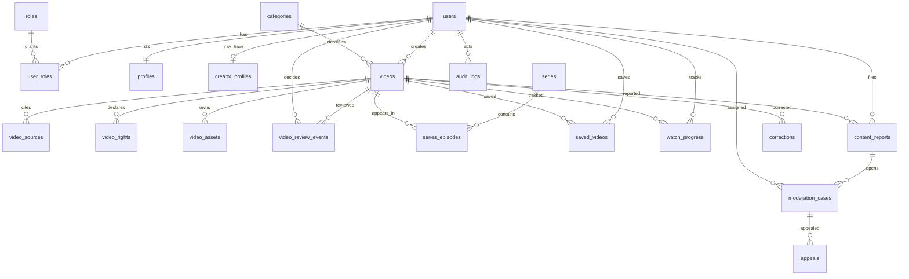

# NUR — Data Model & State Machine

**Status:** baseline Phase 1 (2026-10-20)
**Sumber:** HLD §8, LLD §6/§7, ADR-0003

> LLD §6.2 adalah rincian kolom. Dokumen ini adalah peta relasi, constraint, index, dan aturan migrasi.

## 1. ERD (entitas inti)



Entitas mandiri: `idempotency_keys`, `outbox_events`, `product_events`.

## 2. Aturan relasi & constraint

| Tabel | Constraint kunci | Delete policy |
|---|---|---|
| `users` | `auth_subject` unik | soft-delete (`status`, `deleted_at`); audit dipertahankan |
| `user_roles` | unik pasangan aktif `(user_id, role_id)`; `revoked_at` | revoke, bukan hapus |
| `profiles` | PK `user_id` | ikut user |
| `creator_profiles` | PK `user_id`; status enum | ikut user |
| `videos` | `creator_id` FK; `version` optimistic; check durasi > 0 | soft-delete/arsip; audit dipertahankan |
| `video_sources` | FK video cascade | cascade |
| `video_rights` | FK video cascade; `declaration_by` wajib | cascade, tetapi audit event tetap |
| `video_assets` | unik `(provider_code, provider_asset_id, asset_kind)` | cascade metadata; purge provider via job |
| `video_review_events` | append-only | tidak dihapus |
| `series` | `slug` unik | arsip |
| `series_episodes` | PK `(series_id, video_id)`; unik `(series_id, episode_number)` | cascade |
| `saved_videos` | PK `(user_id, video_id)` | cascade |
| `watch_progress` | PK `(user_id, video_id)`; posisi ≥ 0 | cascade |
| `content_reports` | status enum; reason code valid | tidak dihapus (retensi) |
| `moderation_cases` | FK video/report; status enum | tidak dihapus |
| `appeals` | FK case; status enum | tidak dihapus |
| `corrections` | FK video; status enum | withdraw, bukan hapus |
| `audit_logs` | append-only | tidak dihapus |
| `product_events` | `event_id` unik; `schema_version` | retensi sesuai kebijakan privasi |
| `idempotency_keys` | unik `(scope, key)` | expiry |
| `outbox_events` | status + retry count | arsip setelah terkirim |

Aturan umum:

- UUID untuk seluruh PK; jangan mengekspos sequential ID.
- `timestamptz` UTC; API ISO 8601.
- Semua FK memiliki delete policy eksplisit.
- Enum divalidasi di database (check/constraint) dan di service.
- JSONB hanya untuk metadata fleksibel, bukan pengganti kolom relasional.

## 3. Index minimum

| Tabel | Index |
|---|---|
| `videos` | `(publication_status, published_at DESC)`, `(creator_id, created_at DESC)`, `(category_id, publication_status)` |
| `videos` | GIN `to_tsvector('simple', title || ' ' || coalesce(description,''))` |
| `video_review_events` | `(video_id, created_at DESC)` |
| `series_episodes` | `(series_id, episode_number)` |
| `saved_videos` | `(user_id, created_at DESC)` |
| `watch_progress` | `(user_id, last_watched_at DESC)` |
| `content_reports` | `(status, created_at)`, `(video_id)` |
| `moderation_cases` | `(status, created_at)`, `(assigned_to)` |
| `audit_logs` | `(entity_type, entity_id, created_at DESC)`, `(actor_user_id, created_at DESC)` |
| `product_events` | `(event_name, occurred_at)`, `(user_id, occurred_at)` |

## 4. State machine

### 4.1 Media processing

`initiated → uploading → processing → ready_for_review`
`processing → failed → processing` (retry sah)
`ready_for_review` hanya jika playback + thumbnail minimum siap dan durasi valid.

### 4.2 Editorial

```
draft → submitted → in_review
in_review → revision_requested → submitted
in_review → approved
in_review → rejected
in_review → escalated → in_review
approved → in_review   (re-review terdokumentasi bila metadata material berubah)
```

### 4.3 Publication

```
unpublished → published
published → restricted → published | taken_down
published → taken_down
published → archived
```

Gate: endpoint publik hanya mengembalikan `editorial_status=approved` **dan** `publication_status=published`.

## 5. Migrasi

- Alembic; setiap migration memiliki review dan diuji pada database bersih.
- Perubahan destruktif memakai **expand-migrate-contract** (tambah kolom → backfill → ubah kode → hapus lama).
- Migration produksi memerlukan backup dan rollback plan.
- DILARANG menjalankan drop/truncate otomatis dari CI terhadap data non-test.
- Seed data development diberi label jelas; tidak pernah masuk production.

## 6. Open items yang memengaruhi model

- OD-05/OD-08: retensi dan penghapusan (usia minimum, consent, audit retention).
- OD-17: format bukti hak → memengaruhi `video_rights.permission_evidence_ref`.
- OD-02: kemampuan provider → memengaruhi `video_assets.metadata`.
